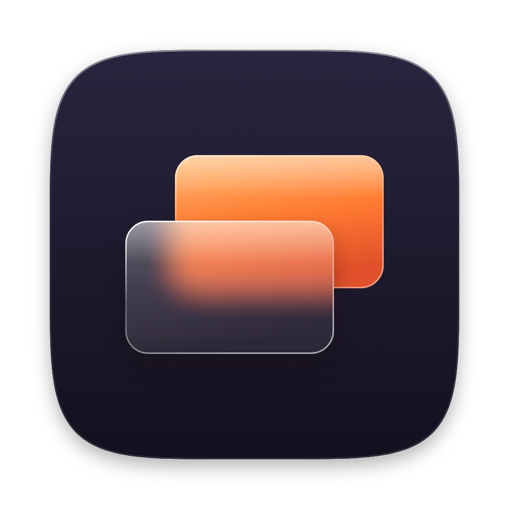
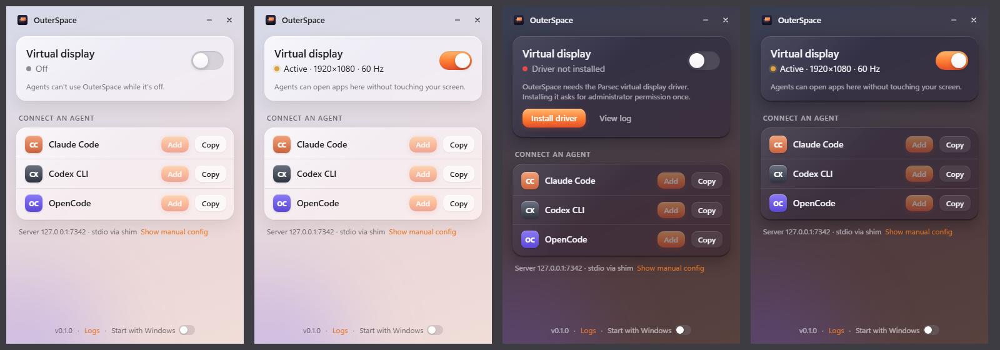

<p align="center">
  
</p>

<h1 align="center">OuterSpace</h1>

<p align="center">
  Um monitor virtual para agentes de IA trabalharem sem atrapalhar você.<br>
  <sub>Windows 11 · Rust + Tauri 2 · MCP · Liquid Glass (macOS 27 Golden Gate)</sub>
</p>

---

> **Status:** em desenvolvimento. O app na bandeja já liga e desliga o monitor virtual (F0 e F1 prontas); as ferramentas MCP vêm a seguir. Veja o [plano de implementação](docs/PLANO.md).

## O que é

O OuterSpace cria um **monitor virtual de verdade** no Windows (um display que a GPU renderiza normalmente) e entrega ele a um agente de IA via **MCP**. O agente abre programas lá, tira screenshots, clica e digita — enquanto você continua usando o seu monitor sem perder o mouse, o teclado ou o foco.

- **Fica na bandeja.** Você inicia uma vez e ele fica em segundo plano.
- **Um switch.** Ligado: o monitor virtual aparece e o servidor MCP aceita chamadas. Desligado: o monitor some e tudo é bloqueado.
- **Setup em um clique** para **Claude Code**, **Codex CLI** e **OpenCode** (ou qualquer cliente MCP).
- **Sem problemas de GPU.** Como é um display ativo, Chrome, VS Code e apps DirectX renderizam como em qualquer monitor — diferente de janelas minimizadas ou desktops ocultos.

<p align="center">
  
  <br><sub>Prévia da UI com dados de exemplo: desligado, ativo, driver ausente e ativo no tema escuro.</sub>
</p>

## Como vai funcionar

```
Claude Code ─┐
Codex CLI  ──┼─ stdio ─▶ outerspace-mcp.exe ─ HTTP local ─▶ OuterSpace.exe (bandeja)
OpenCode   ──┘                                               ├─ monitor virtual (driver IddCx)
                                                             ├─ abrir/mover janelas sem roubar foco
                                                             ├─ screenshot (Windows.Graphics.Capture)
                                                             └─ clique/teclado sem mover seu cursor
```

Ferramentas MCP do MVP: `status`, `launch`, `list_windows`, `screenshot`, `click`, `type_text`, `press_keys`, `scroll`, `move_window`, `close_window`. Detalhes, decisões técnicas e limitações conhecidas estão no [plano](docs/PLANO.md).

O monitor virtual usa o driver **Parsec VDD** (IddCx, assinado pela Parsec). O OuterSpace não embute o driver: no primeiro uso ele baixa o instalador oficial, confere o SHA-256 e pede permissão de administrador uma única vez.

## Conectar um agente (quando o MVP sair)

```sh
# Claude Code
claude mcp add --transport stdio --scope user outerspace -- "%LOCALAPPDATA%\Programs\OuterSpace\outerspace-mcp.exe"

# Codex CLI
codex mcp add outerspace -- "%LOCALAPPDATA%\Programs\OuterSpace\outerspace-mcp.exe"
```

OpenCode é configurado pelo próprio app em `opencode.json` (veja §7 do plano).

## Desenvolvimento

Requisitos: Windows 11, Rust 1.85+ (MSVC), Node 20.19+, WebView2 (já vem no Windows 11).

```sh
cd app
npm install
npm run tauri dev        # app com recarga ao vivo da UI
npm run tauri build      # instalador NSIS em target/release/bundle/nsis
```

```sh
cargo test --workspace                                # testes (não precisam do driver)
cargo clippy --workspace --all-targets -- -D warnings
cargo test -p outerspace-core -- --ignored --nocapture # testes de hardware: precisam do driver Parsec e plugam o monitor de verdade
```

A UI também abre num navegador comum com dados de exemplo (`npm run dev` e depois `http://localhost:5173/?state=on`; outros estados: `off`, `starting`, `error&code=driverMissing`).

| Pasta | O que tem |
|---|---|
| `crates/outerspace-core` | Lógica sem UI: estado liga/desliga, backend do driver (trait `VirtualDisplayBackend`), posicionamento do monitor |
| `app/src-tauri` | App Tauri: bandeja, janela, comandos |
| `app/ui` | Interface (Vite + TypeScript, textos em `src/i18n/en.json`) |
| `assets/icon`, `scripts` | Ícone (gerado por `scripts/gen-app-icon.mjs`, empacotado por `scripts/build-icons.ps1`) |

## Design

A UI e o ícone seguem o **Liquid Glass do macOS 27 Golden Gate**: vidro refinado com refração uniforme, contraste priorizando legibilidade, cantos consistentes, toolbar unificada e ícone em camadas com profundidade. O acento é o laranja "International Orange" da ponte. Tokens e regras estão em §6.3 do plano. A UI é em inglês por padrão.

O ícone é o **Twin**: uma tela laranja e a sua gêmea virtual de vidro fosco. Na bandeja, a tela de trás muda de cor com o estado (laranja ligado, cinza desligado, vermelho com erro). Os candidatos descartados estão em `assets/icon/minimal/` e `assets/icon/variants/`.

## Roadmap

| Fase | Entrega | Status |
|---|---|---|
| F0 | Esqueleto Tauri 2 com bandeja e janela de vidro | ✅ |
| F1 | Monitor virtual liga/desliga pelo switch | ✅ liga em ~0,3 s, desliga em ~1,8 s |
| F2 | Abrir/listar/mover janelas + screenshot + servidor MCP | |
| F3 | Clique, teclado e scroll sem roubar cursor/foco; cerca de mouse | |
| F4 | Shim stdio + setup de Claude Code, Codex e OpenCode | |
| F5 | Polimento visual, instalador, iniciar com o Windows | |

## Licença

[MIT](LICENSE) · avisos de terceiros em [THIRD_PARTY_NOTICES.md](THIRD_PARTY_NOTICES.md)
