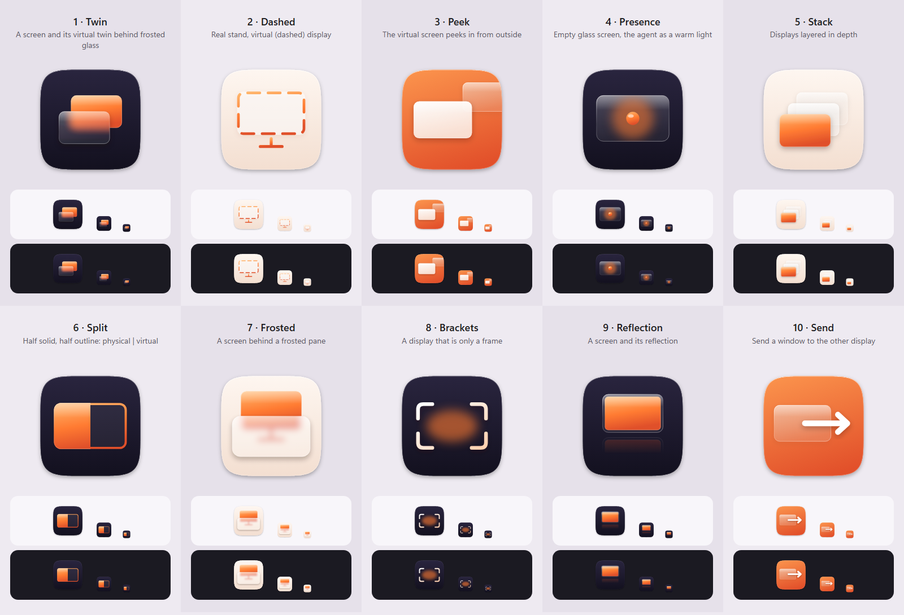

<h1 align="center">OuterSpace</h1>

<p align="center">
  Um monitor virtual para agentes de IA trabalharem sem atrapalhar você.<br>
  <sub>Windows 11 · Rust + Tauri 2 · MCP · Liquid Glass (macOS 27 Golden Gate)</sub>
</p>

---

> **Status:** planejamento. Ainda não há código executável — veja o [plano de implementação](docs/PLANO.md).

## O que é

O OuterSpace cria um **monitor virtual de verdade** no Windows (um display que a GPU renderiza normalmente) e entrega ele a um agente de IA via **MCP**. O agente abre programas lá, tira screenshots, clica e digita — enquanto você continua usando o seu monitor sem perder o mouse, o teclado ou o foco.

- **Fica na bandeja.** Você inicia uma vez e ele fica em segundo plano.
- **Um switch.** Ligado: o monitor virtual aparece e o servidor MCP aceita chamadas. Desligado: o monitor some e tudo é bloqueado.
- **Setup em um clique** para **Claude Code**, **Codex CLI** e **OpenCode** (ou qualquer cliente MCP).
- **Sem problemas de GPU.** Como é um display ativo, Chrome, VS Code e apps DirectX renderizam como em qualquer monitor — diferente de janelas minimizadas ou desktops ocultos.

## Como vai funcionar

```
Claude Code ─┐
Codex CLI  ──┼─ stdio ─▶ outerspace-mcp.exe ─ HTTP local ─▶ OuterSpace.exe (bandeja)
OpenCode   ──┘                                               ├─ monitor virtual (driver IddCx)
                                                             ├─ abrir/mover janelas sem roubar foco
                                                             ├─ screenshot (Windows.Graphics.Capture)
                                                             └─ clique/teclado sem mover seu cursor
```

Ferramentas MCP do MVP: `status`, `launch`, `list_windows`, `screenshot`, `click`, `type_text`, `press_keys`, `scroll`, `move_window`, `close_window`. Detalhes, decisões técnicas e limitações conhecidas estão no [plano](docs/PLANO.md).

## Conectar um agente (quando o MVP sair)

```sh
# Claude Code
claude mcp add --transport stdio --scope user outerspace -- "%LOCALAPPDATA%\Programs\OuterSpace\outerspace-mcp.exe"

# Codex CLI
codex mcp add outerspace -- "%LOCALAPPDATA%\Programs\OuterSpace\outerspace-mcp.exe"
```

OpenCode é configurado pelo próprio app em `opencode.json` (veja §7 do plano).

## Design

A UI e o ícone seguem o **Liquid Glass do macOS 27 Golden Gate**: vidro refinado com refração uniforme, contraste priorizando legibilidade, cantos consistentes, toolbar unificada e ícone em camadas com profundidade. O acento é o laranja "International Orange" da ponte. Tokens e regras estão em §6.3 do plano. A UI é em inglês por padrão.

O ícone está em escolha entre 10 candidatos minimalistas sobre a ideia de monitor virtual:



Todos são gerados por [`scripts/gen-icon-minimal.mjs`](scripts/gen-icon-minimal.mjs) (a rodada anterior, com tema espacial, está em `assets/icon/variants/`):

```sh
node scripts/gen-icon-minimal.mjs assets/icon/minimal
```

## Roadmap

| Fase | Entrega |
|---|---|
| F0 | Esqueleto Tauri 2 com bandeja e janela de vidro |
| F1 | Monitor virtual liga/desliga pelo switch |
| F2 | Abrir/listar/mover janelas + screenshot + servidor MCP |
| F3 | Clique, teclado e scroll sem roubar cursor/foco; cerca de mouse |
| F4 | Shim stdio + setup de Claude Code, Codex e OpenCode |
| F5 | Polimento visual, instalador, iniciar com o Windows |

## Requisitos

- Windows 11 (funciona no Home — não precisa de Hyper-V nem Sandbox)
- Para desenvolver: Rust 1.97+, Node 20+

## Licença

[MIT](LICENSE)
